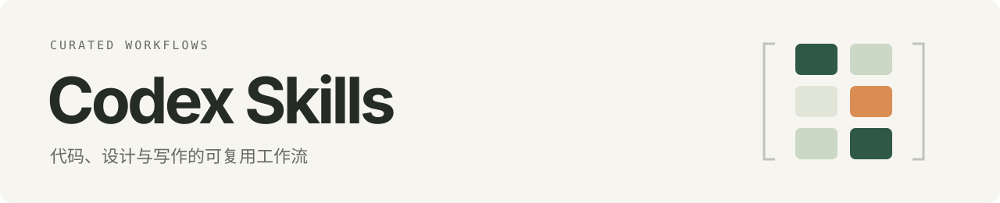

<p align="center">
  
</p>

<p align="center">
  为 Codex 提供工程实践、写作规范与技能维护方法。
</p>

<p align="center">
  <a href="#技能">浏览技能</a>&nbsp;&nbsp;&nbsp;&nbsp;
  <a href="#开始使用">开始使用</a>&nbsp;&nbsp;&nbsp;&nbsp;
  <a href="https://github.com/0xb3i/codex-skills/commits/main">更新记录</a>
</p>

## 技能

| 技能 | 用途 |
| :--- | :--- |
| [**code-master**](skills/code-master/SKILL.md) | 代码实现与审查，处理 review 意见，维护工程契约。 |
| [**ui-standards**](skills/ui-standards/SKILL.md) | 界面与图表的信息呈现、配色和桌面验收规范。 |
| [**writing-style**](skills/writing-style/SKILL.md) | 中文写作与润色，检查文风、结构和事实依据。 |
| [**data-organizer**](skills/data-organizer/SKILL.md) | 整理数据与文档，优化命名、目录和资料查找。 |
| [**mistake-notebook**](skills/mistake-notebook/SKILL.md) | 将长期偏好和项目约束沉淀到 `AGENTS.md`。 |
| [**self-improve-skills**](skills/self-improve-skills/SKILL.md) | 根据执行证据改进技能，维护评测集与回归流程。 |

## 开始使用

需要 Codex、Git 和 rsync，以下命令适用于 macOS / Linux。

<details>
<summary><strong>安装到当前电脑</strong></summary>

```bash
git clone https://github.com/0xb3i/codex-skills.git ~/codex-skills

for skill_dir in ~/codex-skills/skills/*; do
  skill_name=$(basename "$skill_dir")
  mkdir -p "$HOME/.codex/skills/$skill_name"
  rsync -a --delete --exclude __pycache__ --exclude '*.pyc' --exclude .DS_Store \
    "$skill_dir/" "$HOME/.codex/skills/$skill_name/"
done
```

完整覆盖这六个同名技能，保留其他本地技能。只安装部分技能时，将循环路径改为所选技能目录。

后续更新先运行 `git -C ~/codex-skills pull --ff-only`，再执行上面的同步循环。

</details>

`code-master` 的内部代码平台适配需要对应环境；`self-improve-skills` 创建技能时使用 Codex 内置的 `skill-creator`。

---

按需收录，以当前激活版本更新，移除未激活的旧技能。公开副本中的个人信息与内部写作素材已脱敏。
